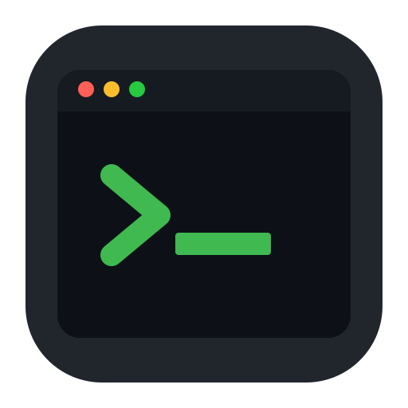

# mitr

<p align="center">
  
</p>

A minimalist terminal emulator for Linux and macOS, written in C23 with SDL2.
It supports common VT and xterm sequences, scrollback search, mouse selection,
true color, and HiDPI fonts. Settings live in a YAML file.

## Build and run

You need GCC 13+ or Clang 15+ and Make. The default build uses the library
sources included in `vendor/`.

```sh
git clone https://github.com/daniilperestoronin/mitr.git
cd mitr
make deps          # install build tools and system libraries; may use sudo
make vendor        # build bundled dependencies once
make release
./build/mitr
```

`make deps` supports Debian/Ubuntu, Fedora, Arch Linux, and macOS with
Homebrew. It installs CMake and autotools for the vendor build, plus Python 3,
gettext/Autopoint, and X11 development libraries on Linux. Use
`make check-deps` to check an existing setup, or `make deps DEPS_DRY_RUN=1`
to preview package commands.

To use system libraries instead:

```sh
make deps USE_VENDOR=0
make clean
make release USE_VENDOR=0
```

Plain `make` builds with debug symbols, ASan, and UBSan. For direct debug
and release builds, run `make clean` when switching build mode or dependency
source: these configurations share output files. Installation handles its
own rebuild. Cleaning keeps the vendor build; `make clean-all` removes it too.

Dependency versions are in [vendor/VERSIONS.md](vendor/VERSIONS.md).
Build and test commands for contributors are in [AGENTS.md](AGENTS.md).

## Install

For a user-local installation:

```sh
make install PREFIX="$HOME/.local"
```

`make install` runs `make clean`, then `make release` before installing.
No manual clean is needed; built vendor libraries are kept.
Add `$HOME/.local/bin` to `PATH` if needed.
Without `PREFIX`, the install location is `/usr/local` and may require sudo.

| Platform | Installed files |
|----------|-----------------|
| Linux | `PREFIX/bin/mitr`, `PREFIX/share/applications/mitr.desktop`, hicolor icons |
| macOS | `APPDIR/mitr.app`, with a symlink at `PREFIX/bin/mitr` |

On macOS, `APPDIR` defaults to `/Applications`, or `~/Applications` when
`PREFIX` is under `$HOME`. Set `APPDIR=/path` to override it.
For packaging, use `DESTDIR`, for example
`make install DESTDIR=/tmp/stage PREFIX=/usr`; launcher paths omit the staging root.

Remove an installation with `make uninstall`, using the same `PREFIX` and
`APPDIR`. The sample configuration is not installed automatically.

## Use

```sh
./build/mitr                     # use $SHELL, or /bin/sh if unset
./build/mitr --config path.yml    # use a specific configuration
./build/mitr --help
```

On macOS, mitr starts a login shell. For zsh, this loads `/etc/zprofile` and
`~/.zprofile`. A launch with working directory `/` (usually Finder or Dock)
starts the shell in `$HOME`; launches from another directory keep it.
Linux does not force login-shell mode. The shell receives a limited set of
[environment variables](ARCHITECTURE.md#pty-and-shell).

Logs go to stderr. mitr does not prevent the screensaver or system sleep.

### Keyboard and mouse

| Action | Shortcut |
|--------|----------|
| Quit | Ctrl+Q |
| Copy selection | Ctrl+C or Cmd+C; selecting with the mouse also copies on release |
| Paste | Ctrl+V, Cmd+V, Shift+Insert, or middle-click |
| Search | Ctrl+Shift+F or Cmd+Shift+F |
| Next / previous match | Enter or Ctrl+G / Shift+Enter |
| Leave search | Esc |
| Scroll history | Shift+PageUp / Shift+PageDown on the main screen |
| Select text / word / line | Drag / double-click / triple-click |
| Open an OSC 8 link | Ctrl/Cmd+left-click; only `http://` and `https://` |

Without a selection, Ctrl+C goes to the shell as usual. Search covers history
and the live screen, or just the live screen in an alternate-screen application.
It wraps, ignores ASCII letter case, and does not support regular expressions
or Unicode case folding.

F1–F12 and navigation keys use xterm sequences, including Shift/Alt/Ctrl
modifiers. Alt+letter sends an ESC prefix. Paste honors bracketed-paste mode.

The mouse wheel scrolls history on the main screen. In alternate-screen
applications it sends Up/Down while alternate-scroll mode (1007) is enabled;
otherwise it does nothing. PageUp/PageDown, including Shift, go to the
application on the alternate screen.

When an application enables mouse reporting, clicks and wheel events go to
it. Hold Shift to select text or open links locally; Shift+wheel scrolls
mitr's history on the main screen. Horizontal scrolling and fractional
trackpad movement are supported. New clicks in window padding are ignored;
an active drag continues to the nearest grid edge.

## Configuration

With `--config`, mitr uses that file. Otherwise it looks for:

1. `$XDG_CONFIG_HOME/mitr/mitr.yml`
2. `~/.config/mitr/mitr.yml`
3. Built-in defaults if neither file exists

Start with the [sample configuration](assets/mitr.yml):

```sh
mkdir -p ~/.config/mitr
cp assets/mitr.yml ~/.config/mitr/mitr.yml
```

| Section | Settings |
|---------|----------|
| `window` | `width`, `height`, `opacity`, `resizable`, `padding.x`, `padding.y` |
| `font` | `family`, `size`, `path`, `fallback_path` |
| `cursor` | `style` (block, underline, bar), `color`, `blink`, `blink_interval` |
| `colors` | `foreground`, `background`, `selection`, 16 ANSI colors |
| `terminal` | `shell`, `term`, `scrollback_lines`, `bold_is_bright`, `osc52` |

The default font is JetBrains Mono at size 16. With an empty `font.path`,
mitr resolves `font.family` through Fontconfig on Linux or CoreText on macOS.
Missing glyphs use system fallback fonts; `font.fallback_path` can supply
an explicit second TTF/OTF font. Fonts scale for HiDPI displays.

History holds 10,000 lines by default; `terminal.scrollback_lines: 0`
disables it. To change the palette, copy a commented `colors:` block from
the sample file. There is no theme-name setting. ANSI colors also accept
`color0` through `color15`; `colors.cursor` aliases `cursor.color`.

`terminal.osc52` controls whether programs can write to the clipboard:

- `off` (default): ignore writes.
- `confirm`: ask first, showing the payload length and up to 80 preview characters.
- `on`: allow writes.

Clipboard queries are always ignored. Regular copy and paste work regardless
of this setting.

## Terminal compatibility

mitr implements the following VT and xterm features. This is not a claim of
complete compatibility with every terminal standard.

| Area | Supported features |
|------|--------------------|
| Cursor | CUU/CUD/CUF/CUB, CUP/HVP, CHA/HPA, VPA, DECSC/DECRC |
| Editing | ED/EL/ECH, ICH/DCH, IL/DL, insert/replace mode (IRM), REP |
| Scrolling and tabs | DECSTBM, IND/RI, SU/SD, HT/HTS/TBC/CBT |
| Controls | LF, CR, BS, BEL, NEL |
| Appearance | Bold, dim, italic, underline, reverse, concealed, strikethrough; 16/256 colors and true color |
| Modes | DECOM, DECAWM, DECTCEM, DECCOLM, DECSCNM, DECCKM, DECKPAM/DECKPNM, alternate screen, RIS/DECSTR |
| Input | Bracketed paste; mouse 1000/1002/1003 with UTF-8 (1005) and SGR (1006) coordinates; alternate scroll (1007) |
| Window | Titles (OSC 0/2), hyperlinks (OSC 8), clipboard writes (OSC 52) |
| Focus | Mode 1004 sends `CSI I` / `CSI O` on focus changes; enabling it emits no reply |
| Synchronized output | Mode 2026 updates the buffer immediately and defers presentation until reset or about 150 ms after the latest enable |

Primary DA replies with `ESC[?1;2c`, secondary DA with `ESC[>0;0;0c`.
DSR 5 replies with `ESC[0n`; DSR 6 reports `ESC[row;colR` using 1-based
coordinates relative to the scrolling origin when DECOM is set.
CHA/HPA default to column 1 and do not shift horizontally with DECOM.
REP defaults to one extra copy of the last graphic character and does
nothing before one has been written. OSC 8 `id=` parameters are ignored.

### Limitations

- Unicode support covers character width and combining marks, without full
  grapheme clusters or ligatures.
- Cursor and text blink are not animated; cursor blink settings are stored only.
- OSC 1 icon names are parsed but not applied.
- Sixel and other DCS payloads are not rendered.
- ED 3 is accepted but does not clear scrollback.
- Windows / ConPTY is not implemented.

## Contributing

Read [AGENTS.md](AGENTS.md) for conventions and checks, and
[ARCHITECTURE.md](ARCHITECTURE.md) for the module map and internals.
Release notes are in [CHANGELOG.md](CHANGELOG.md).

## License

MIT; see [LICENSE](LICENSE). Third-party licenses are listed in [NOTICE](NOTICE).
Vendored FreeType uses the [FreeType License](vendor/freetype/docs/FTL.TXT),
not its alternative GPL license.

Portions of this software are copyright © 1996-2024 The FreeType
Project (www.freetype.org). All rights reserved.
